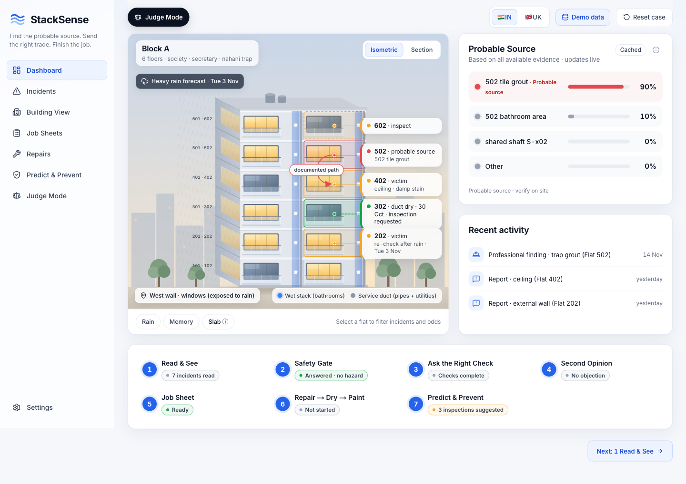
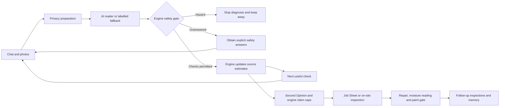
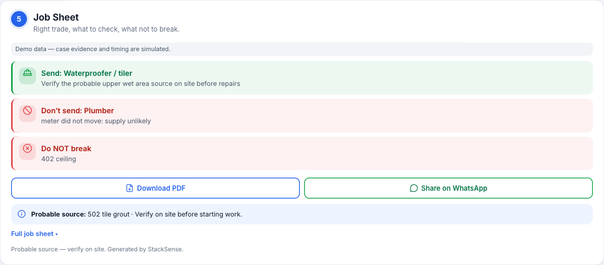
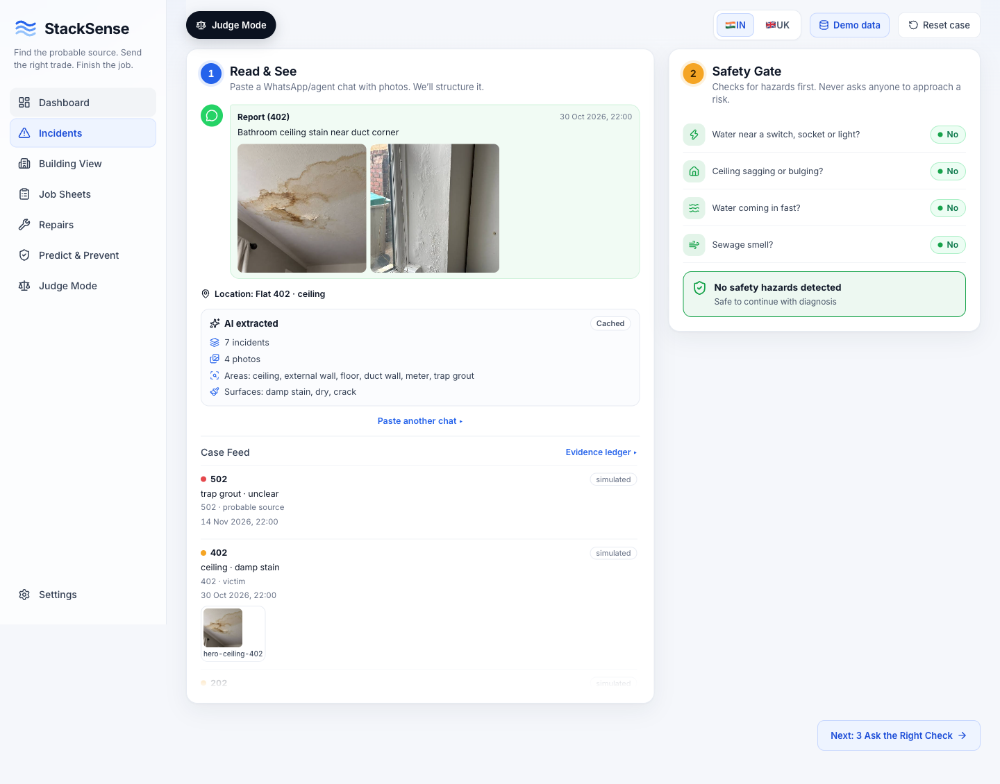

# StackSense

**Investigate building leaks. Ask the next useful check. Send an evidence-based repair brief.**

StackSense helps housing societies and property managers turn scattered chat messages, photos and resident checks into a **probable source**, a **safe next step**, and a **Job Sheet** explaining which trade to send—and which work is not justified yet.

**[Open the live app](https://stacksense-omega.vercel.app/) · [Try the guided demo](https://stacksense-omega.vercel.app/judge) · [Evaluation details](docs/RESULTS.md) · [Run locally](#run-locally)**

> **Decision-support prototype, not a confirmed diagnosis.** Verify the probable source on site. Demo scenarios use simulated evidence and timing; evaluation results are team-built tests, not field accuracy.



*Actual screenshot of the original live app after the scripted hero demo. The displayed probabilities belong to that simulated case; they are not a claim of real-world accuracy.*

## Start here: a two-minute walkthrough

1. Open **[Judge Mode](https://stacksense-omega.vercel.app/judge)**. Keep **Hero: evidence before repairs** selected.
2. Press **Play**, or use **Next step** to inspect the evidence one step at a time.
3. Visit **[Dashboard](https://stacksense-omega.vercel.app/)** and **[Building View](https://stacksense-omega.vercel.app/building)** to see the building, source estimates, requested checks and review. The case stays with you as you navigate.
4. Open **[Job Sheets](https://stacksense-omega.vercel.app/job-sheet)** to see **Send**, **Don’t send**, **Do NOT break**, site-verification instructions and the PDF/WhatsApp actions.
5. Continue to **[Repairs](https://stacksense-omega.vercel.app/repairs)** for repair, drying and paint readiness, then **[Predict & Prevent](https://stacksense-omega.vercel.app/predict)** for inspection suggestions.

**Explore a counterfactual:** return to Judge Mode and change an available What-if switch. The engine replays the evidence; the remaining evidence determines whether the source or trade changes. Switches stay disabled until their observations exist.

**Trying chat import instead?** Open [Incidents](https://stacksense-omega.vercel.app/incidents) and choose **Load demo chat** or paste an export. Importing a complaint does **not** answer the safety questions. An incomplete safety gate and an unavailable Job Sheet are expected until the required evidence arrives. Use the guided demo to see a complete scripted case.

## The workflow

A ceiling stain does not automatically prove the flat above caused it. StackSense keeps the reports, source hypotheses, requested checks and repair decision connected.

| Stage | What happens | What the user gets |
| --- | --- | --- |
| **Read & See** | Prepare chat/photos; extract structured reports; associate evidence with flats | An evidence feed and building view |
| **Safety Gate** | Check for water near electrics, sagging ceilings, fast ingress and sewage | Emergency guidance, or an explicit incomplete/safe-for-checks state |
| **Ask the Right Check** | Rank available checks by expected information versus effort and access | A reasoned next check, such as a duct photo or meter reading |
| **Second Opinion** | Review contradictions and whether the proposed claim is too specific | A cautious review, evidence gaps and a capped claim |
| **Job Sheet** | Turn a supported decision into a repair brief—or request on-site inspection when remote evidence is insufficient | Trade, reason, access, verification and work not justified yet |
| **Repair → Dry → Paint** | Record repair and moisture evidence separately | Paint readiness based on a recorded reading, never appearance alone |
| **Predict & Prevent** | Use the case, building relationships and weather to suggest follow-up | Same-stack inspections, rain rechecks, seasonal tasks and building memory |



### A concrete example

In the scripted hero case, flat **402** reports a ceiling stain. A **dry duct at 302** weakens the shared-shaft explanation. A **still meter at 502** weakens the supply-leak explanation. Trap/grout evidence and the scripted professional finding support a probable wet-area defect.

The resulting demo Job Sheet sends a **waterproofer/tiler**, explains why a plumber is not justified by that evidence, and warns against breaking the **402 ceiling**. This is an illustration of the workflow, not a diagnosis from a stain photograph alone.



<details>
<summary><strong>See the evidence feed and Safety Gate</strong></summary>



Screenshots were captured from **stacksense-omega.vercel.app** in a disposable demo browser session. No real resident submission or live AI call was needed to produce these scripted-demo screenshots.

</details>

## What is AI—and what is not?

| Capability | AI’s role | Deterministic control |
| --- | --- | --- |
| Chat reading | Extract reported facts into a validated schema | Privacy preparation, incident handling and hazard backstop |
| Photo reading | Label visible surface/zone and readable meter digits | Metadata removal, quality/size checks; no invented digits or moisture measurement |
| Second Opinion | Draft objections, evidence gaps and a cautious claim | Engine caps specificity and retains control of the decision |
| Source odds, next check and trade | **AI does not decide these** | Building graph, prototype priors, likelihoods and rule tables |
| Safety, recovery and paint readiness | **AI cannot override these** | Explicit evidence gates and recorded measurements |
| Weather, memory and simulation | No model judgement | Weather data, storage and engine logic |

**Read the badges literally:** **Live** means a fresh model result; **Cached** means a reused result; **Fallback** means the model was unavailable or its output unusable. **Demo data** marks simulated case evidence/timing. A cached or scripted demo is not proof of a fresh live AI call.

Details: [AI, prompts and privacy](docs/ai.md) · [Engine rules](docs/engine.md) · [Free-tier and quota setup](docs/QUOTA_SETUP.md).

## Where each feature lives

| Page | Purpose |
| --- | --- |
| [Dashboard](https://stacksense-omega.vercel.app/) | Building overview, probable sources and case progress |
| [Incidents](https://stacksense-omega.vercel.app/incidents) | Import, evidence ledger, photo review and safety status |
| [Building View](https://stacksense-omega.vercel.app/building) | Building details, next check and Second Opinion |
| [Job Sheets](https://stacksense-omega.vercel.app/job-sheet) | Dispatch brief, unsupported work, PDF and WhatsApp sharing |
| [Repairs](https://stacksense-omega.vercel.app/repairs) | Repair, moisture readings, recapture and paint readiness |
| [Predict & Prevent](https://stacksense-omega.vercel.app/predict) | Related-flat inspections, forecast rechecks, seasonal tasks and memory |
| [Judge Mode](https://stacksense-omega.vercel.app/judge) | Eight scenarios, What-if, decision trace, evaluation and Break it |
| [Settings](https://stacksense-omega.vercel.app/settings) | IN/UK region, building facts, data labels and reset |

The **core product** is the evidence-to-check-to-Job-Sheet workflow. Weather, prevention and memory extend it. Judge Mode, What-if and Break it explain/test it; they are not a substitute for a real resident investigation. Empty prevention panels mean no recommendation has been produced yet, not that an inspection found no risk.

## Evaluation: useful evidence, limited claims

<!-- eval:start -->
**Team-built test, not field accuracy.** The checked-in run dated 31 October 2026 covers **30 frozen hard cases and 60 simulated buildings**. “All cases” means those 90 test cases.

| Method | Right trade: 30 hard cases | Right trade: all 90 cases | Source top-1 after 3 checks: all cases |
| --- | ---: | ---: | ---: |
| StackSense | 66.7% | 45.6% | 82.5% |
| Blame the flat above | 23.3% | 31.1% | 36.3% |
| Send a trade straight away | 20.0% | 17.8% | 21.3% |
| Fixed checklist | 63.3% | 46.7% | 80.0% |
| StackSense without Second Opinion | 66.7% | 45.6% | 82.5% |

**Read the scope:** 66.7% is the hard-case right-trade result, not overall accuracy. Source top-1 and right-trade rate measure different outcomes. StackSense’s right-trade result on simulated cases alone is **35.0%**.

The fixed checklist slightly beats StackSense on overall right-trade rate. The offline Second Opinion ablation ties StackSense; this run does **not** establish an improvement from a live AI reviewer. The single-LLM baseline has only 16 of 30 hard-case answers and is not scored as complete. StackSense passed the included hazard tests; that is not a guarantee for every real hazard.

**AI reading is only partially measured:** 109 messages were reviewed, but only **15 English messages** were measured with the live provider. Flat-ID F1 on that small subset is **30.8%**, a known weakness. Photo accuracy and clean-wall false positives remain **unmeasured**; the published photo evaluation count is **0**. These results do not establish multilingual or photographic reliability.
<!-- eval:end -->

[Full results, metric definitions, ties and losses](docs/RESULTS.md) · [Published evaluation JSON](https://stacksense-omega.vercel.app/eval/latest.json)

## Safety, privacy and limitations

- **Probable source, never guilty flat.** Responsibility is shown as reference links, not a liability decision.
- **Unanswered is not safe.** Hazards stop ordinary diagnosis and resident-check instructions.
- **A photograph cannot measure moisture.** A recorded, suitable moisture reading and the engine’s recovery gates are required before paint readiness.
- No invented savings, guessed meter digits, meter checks without a meter, or automatic bundled repairs.
- Browser preparation pseudonymises chat contacts and strips photo metadata; the server repeats defensive preparation. The prototype is **not a guarantee of complete de-identification**.
- Resident photos use private storage and signed links. Approved demo photographs are intentionally public references; scenario observations and timing remain simulated. Unmatched scenes use labelled illustrations.
- AI may be wrong, unavailable or quota-limited. Every model output is schema-validated, with bounded repair/fallback behavior. On-site verification remains necessary.
- Priors, likelihoods, trade rules and moisture thresholds are prototypes requiring contractor review. There is no field validation or production-reliability claim.

## Run locally

Use **Node 20** and **pnpm 9**.

```bash
git clone https://github.com/aaranarc/stacksense.git
cd stacksense
pnpm i
pnpm --filter web dev
```

Open [localhost:3000](http://localhost:3000). Keep local settings in `apps/web/.env.local`; never commit it.

| Configuration | Needed for |
| --- | --- |
| `NEXT_PUBLIC_DEMO_MODE` | Enable the explicitly simulated `/c/demo` resident flow |
| `GEMINI_API_KEY`; optional `GEMINI_MODEL`, `GEMINI_FALLBACK_MODEL` | Fresh Gemini reading/review; absent keys still allow valid known caches and labelled fallback |
| `SUPABASE_URL`, `SUPABASE_SERVICE_ROLE_KEY`, `MAGIC_LINK_SECRET`, `APP_ORIGIN` | Persistent/private storage and real signed resident links/uploads |
| `OPENAI_BASE_URL`, `OPENAI_MODEL`, `OPENAI_API_KEY`, provider selectors | Optional explicitly configured compatible provider |

Do not enable mock engine/API flags when verifying real integration. Never put a model key, service-role key or signing secret in a `NEXT_PUBLIC_` variable. See [complete configuration and handoff](docs/HANDOFF_A.md) and [quota setup](docs/QUOTA_SETUP.md).

### Checks

```bash
pnpm -r typecheck
pnpm -r test
pnpm --filter web build
```

Tests, evaluation and diagnostic warm-up must not consume live LLM quota unless `LIVE_LLM_TESTS=1` is explicitly enabled. Exact known demo inputs are cache-first. Uncached interactive requests with configured keys can still consume quota. Evaluation reproduction is documented in [RESULTS.md](docs/RESULTS.md#reproduce); it is separate from the ordinary checks above.

## Architecture and further reading

```text
packages/contracts/    Shared Zod schemas
packages/engine/       Pure TypeScript inference, safety, checks, trade and recovery
packages/ai/           Readers, prompts, privacy helpers, caches, weather and signed links
apps/web/              Next.js pages and thin API routes
fixtures*/             Simulated cases, approved demo assets and cached outputs
eval/                  Evaluation data, runners and results
```

**Stack:** Next.js · React · TypeScript · pnpm · Zod · Gemini/optional compatible provider · Supabase · Open-Meteo.

[Engine](docs/engine.md) · [AI and privacy](docs/ai.md) · [Evaluation](docs/RESULTS.md) · [Quota setup](docs/QUOTA_SETUP.md) · [Handoff](docs/HANDOFF_A.md)

## Team

- **A:** engine, AI pipeline, APIs and data.
- **B:** application screens, resident mobile flow and recordings.
- **C:** evaluation, Judge Mode, README and video editing.
