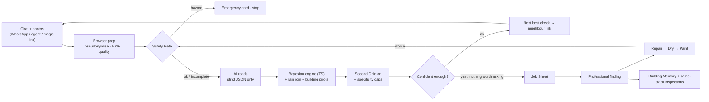

# StackSense

**Find where the water is really coming from — ask the one neighbour check that matters, refuse to over-claim, and send the right trade the first time.**


<!-- B: replace docs/demo.gif with the demo GIF and add the video link here. -->

## Try it
- **Live app:** https://stacksense-omega.vercel.app/
- **Judge Mode:** press **Judge Mode** in the top bar. Inside:
  - **What-if** sliders — flip "302 duct dry ↔ wet", "502 meter still ↔ moved"… and watch the odds, Second Opinion and Job Sheet change live.
  - **Scenarios** — 8 stories with **Next step ▸ / Play / Reset**: Happy path · Electrical hazard · Locked 502 · Dark photo · Horizontal beam travel · Wrong-trade save (rain) · Honest uncertainty · Break it.
  - **Evaluation** — the real numbers below, ties and losses marked.
  - **How it decided** — every update as a plain line: "302 duct wall dry → shared shaft 31% → 6%".
  - **Break it** — pick a building size and a hidden source (or an electrical hazard); answer the engine's checks yourself or let the simulator answer.

## The problem
A stain appears on a ceiling in a block of flats. Everyone blames the flat above; nobody knows which trade to send.
Wrong trades, repeat visits and needless demolition follow, and emergencies (water near electrics) get handled late.
The evidence already exists — scattered across a WhatsApp group, a few photos and the weather — but nobody joins it up.
And "looks dry" gets painted over before it is dry.

## How it works


## What is AI and what isn't
The AI only **reads** (chat text and photos → schema labels) and **drafts** the Second Opinion.
Odds, check choice, safety, trade and statuses are **deterministic engine code** (`packages/engine`) — the same module the UI and the evaluation use.
If the AI is down you get a labelled fallback, never a fake result. Details: [docs/ai.md](docs/ai.md).

## Evaluation
<!-- eval:start -->
**Team-built test, not field accuracy.** 30 frozen hard cases + 60 simulated buildings · generated 2026-10-31 by `pnpm eval`.

| Method | Right trade (hard cases) | Right trade (all) | Top-1 after 3 checks | Over-claim | Hazard pass |
|---|---|---|---|---|---|
| StackSense | 67% | 46% | 83% | 1% | 100% |
| Blame the flat above | 23% | 31% | 36% | 63% | 0% |
| Send a trade straight away | 20% | 18% | 21% | 7% | 0% |
| Fixed checklist | 63% | 47% (loses) | 80% | 0% (loses) | 100% (tie) |
| StackSense without Second Opinion | 67% (tie) | 46% (tie) | 83% (tie) | 1% (tie) | 100% (tie) |
| Single LLM, same evidence | pending — free-tier AI quota (16/30 hard cases answered); rerun LIVE_LLM_TESTS=1 eval/runner/llm-baseline.ts | | | | |

AI reading (partial): message extraction measured on 15 of 109 human-reviewed messages (free-tier quota); photo accuracy not measured — too few photos, free-tier quota; cost $0 (free tier).

(tie) / (loses) = StackSense ties or loses to that method on that metric. Robustness: top-1 after 3 checks -40% → 38%, -20% → 63%, 0% → 83%, +20% → 90%, +40% → 95% (true family's prior shifted).
<!-- eval:end -->

Full table, what every metric means and **every tie and loss written out**: [docs/RESULTS.md](docs/RESULTS.md).

## Trust rules
1. "Probable source", never "guilty flat"; who pays appears only as links.
2. A photo cannot measure moisture — "ready to paint" needs a recorded moisture reading.
3. No invented money figures; we say "work not justified yet".
4. No meter check where no meter exists.
5. Prevention means inspection first, never bundled repairs.
6. No self-reported AI confidence used as a threshold.
7. AI down → labelled fallback, never a fake result.
8. Pseudonymise and strip EXIF in the browser before anything leaves it; photos private; consent on every neighbour request.
9. An unanswered hazard question is "incomplete", never "safe"; nobody is asked to approach a hazard.

## Architecture
```
stacksense/                 pnpm monorepo, Next.js + TypeScript on Vercel
├─ packages/contracts/      Zod schemas — the shared contract
├─ packages/engine/         pure TS engine: Bayes update, safety gate, next-best check, Second Opinion caps,
│                           Job Sheet, Repair → Dry → Paint, predictions, scenarios, simulator
├─ packages/ai/             LLM adapter + prompts, browser prep, weather (Open-Meteo), Supabase, magic links
├─ apps/web/                the app (Next.js) + API route handlers
├─ eval/hard-cases/         30 hard cases, frozen at tag eval-frozen
├─ eval/runner/             engine evaluation, baselines, robustness, merge → apps/web/public/eval/latest.json
└─ eval/runner-ai/          AI reading evaluation on human-labelled data
```
Data: Supabase (Postgres + private Storage). Weather: Open-Meteo (CC-BY 4.0). Demo mode runs from bundled fixtures.

## Run locally
```bash
pnpm i && pnpm --filter web dev
```
Server keys go in `apps/web/.env.local` (never committed). Without them the app runs in labelled fallback / demo mode.
Evaluation: `pnpm eval` (see [docs/RESULTS.md](docs/RESULTS.md#reproduce)).

## Limitations
- The evaluation is a **team-built test, not field accuracy**: 30 hard cases written by the team plus a simulator.
- Priors and the trade table are **prototypes, contractor review pending**.
- **No field validation yet.** The AI evaluation covers only the messages and photos the team has hand-labelled.
- The Second Opinion needs a live LLM; offline it is a labelled fallback.

## Team
- **A** — core: engine, AI pipeline, APIs, data.
- **B** — app: every screen, mobile neighbour pages, video recording, submission.
- **C** — evaluation, Judge Mode, README, video edit.
<!-- Names/handles to be added by the team. -->
