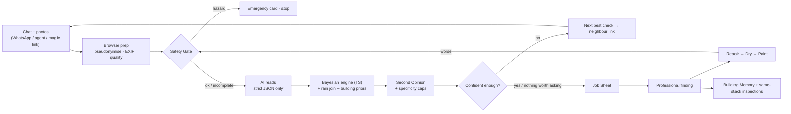

# StackSense: Final Plan (v3, decluttered)

**28 Oct 2026** · Submission: demo video + deployed link · Target: **≈ 9.2–9.3 / 10**
This version replaces the 37-feature list with **7 core modules + Judge Mode**. Nothing that carries the USP is removed. Small features are folded into the modules they belong to, and anything secondary sits one click away instead of on the main screen.

---

## 0. The idea in one breath

> **StackSense finds where the water is really coming from. It reads the complaints and photos, asks the one neighbour check that matters most, shows the odds move live, refuses to over-claim, and sends the right trade the first time. Then it follows the repair until the ceiling is truly ready to paint, and predicts where to look next.**

**USP (what no single competitor does together):**
1. **The app chooses the next check**, by information gained per minute of a neighbour's effort.
2. **A Second Opinion** that blocks over-confident diagnoses.
3. **A contractor-ready Job Sheet**: right trade, wrong trade, and what not to break.
4. **Repair ≠ dry ≠ ready to paint**, tracked as three separate steps.
5. **Spatial prediction from day one**: building-type priors, rain-forecast re-checks, and same-stack inspections.

---

## 1. Problem and judges (short)

- **Problem statement:** *detect or predict leaks, dampness, damage, or maintenance requirements.*
- **Judges:** a UK repair contractor. Their losses: wrong trade, repeat visits, needless demolition, repaint callbacks, emergencies handled late.
- **Our testbed:** Mumbai housing societies (WhatsApp complaints, "not my flat" disputes). The same engine runs with UK labels.
- **Design rule:** every result ends with **who to send, what to check, and what not to break**.

---

## 2. The 7 modules + Judge Mode

| # | Module | What it does | Folded in (no separate screen) |
|---|---|---|---|
| 1 | **Safety Gate** | Water near electrics, sagging ceiling, fast ingress or sewage → red Emergency card, diagnosis stops. Runs first and again on every new observation | Never asks anyone to approach a hazard; an unanswered hazard question stays "incomplete", never "safe" |
| 2 | **Read & See** | Paste a WhatsApp/agent chat with photos → structured observations; complaints grouped into incidents; the building lights up | Sender → flat chips · pseudonymise + EXIF strip in the browser · photo quality check · whole-view + detail-crop vision · meter-digit reading · "AI says ✓ / wrong?" correction · prompt-injection safe (schema-only output) |
| 3 | **Ask the Right Check** | Deterministic Bayesian engine ranks sources and picks the **next best check** (information ÷ effort); bars update live | Action catalog (duct photo, trap/grout photo, meter check *only if a meter exists*, dye test as a slow option) · locked-flat fallback · rain history joined automatically · stop rule ("remote evidence can't decide → inspect X") |
| 4 | **Second Opinion** | After each update: *objection / needs evidence / no objection / review failed*. Code caps how specific a claim may be | "502 bathroom area" is allowed before "nahani trap failed" · "no objection" ≠ confirmed |
| 5 | **Job Sheet** | Send / **don't send** (with the reason) / access route / verify on site / **work not justified yet** / safety flags / evidence photos | PDF + WhatsApp share · region labels 🇮🇳/🇬🇧 · responsibility shown only as links · UK mode: report-date timestamp trail for compliance |
| 6 | **Repair → Dry → Paint** | Three separate statuses; a Day-14 recapture with a ghost outline; "ready to paint" only after a recorded moisture reading | Better-looking photo ≠ dry · worse photo → case reopens · a recurrence at the same spot flags the earlier repair |
| 7 | **Predict & Prevent** | **Day one:** building-type priors + rain-forecast re-checks for exposed walls. **After a confirmed defect:** same-stack flats flagged for 1-minute inspection photos. **Over time:** Building Memory learns from confirmed outcomes | Seasonal tasks generated from this building's cases, not a generic list |
| ★ | **Judge Mode** | What-if sliders · scenario picker (including "Break it") · live evaluation card | "How it decided" trace lives inside the evaluation card |

**Removed from the main product (kept only in the README, or dropped):**
- 4-layer slab explainer → becomes a tooltip on the slab.
- Stain-edge contrast slider → a small toggle inside the photo viewer, labelled "edge contrast, not moisture."
- Standalone audit drawer, standalone compliance clock, warranty tracker → folded in as above.

---

## 3. System workflow



**Iron rule:** the AI only **reads** (text and photos into labels) and drafts the Second Opinion. **Odds, check choice, safety, trade and statuses are all deterministic code**, the same engine module used by the UI and by the evaluation.

### Hero case flow
1. 402 complains of a bathroom ceiling stain; 202 has a wall stain near the window; 502 says "our floor is dry."
2. Safety: no hazard, so continue.
3. The AI reads the photos: 402 stain near the duct corner; 202 external wall with salt deposits.
4. Rain history matches 202's reports, so 202's façade hypothesis rises.
5. 502's "dry floor" barely counts: a sunken-slab leak rarely wets the tiles above.
6. Next best check: **302 duct-wall photo**. It is dry, so the shaft goes green and 202 splits off as a façade case.
7. Next: **502 meter** (meter present). It doesn't move, so the supply pipe drops.
8. **Second Opinion:** "evidence supports the 502 bathroom area, not a specific component." It asks for a trap photo.
9. Trap photo: cracked grout at the trap. The component is now "probable."
10. **Job Sheet:**
    - waterproofer/tiler, **not** a plumber
    - flood test to verify
    - don't break 402's ceiling
11. Repair, then Day 14: looks better, but still **not ready to paint** until the moisture reading.
12. Prevention: **302 and 602 amber** for 1-minute inspection photos. Building Memory: +1 wet-area case. 202 gets a re-check scheduled after the next forecast heavy rain.

---

## 4. Engine (the technical core)

| Part | How |
|---|---|
| Hypotheses | Upper-flat wet area · upper-flat supply · shared shaft · façade/window · roof/terrace · condensation · other. Levels: mechanism → area → component |
| Priors | **Building-type archetype** (e.g., 1990s Mumbai RCC, stacked bathrooms, sunken slabs; UK 1960s block), expert-elicited and contractor-reviewed, stored as ranges |
| Likelihoods | P(observation \| source) tables, e.g., duct dry \| shaft leak = low; floor dry \| slab leak = high |
| Update | Bayes in pure TypeScript; repeated reports of one event count once |
| Next check | (expected entropy reduction) ÷ (effort minutes × access penalty). Unsafe or unavailable checks are excluded; checks that can't change the action are skipped |
| Stop | Leading source ≥ 80% **and** no Second Opinion objection, or no check is worth its cost → "inspect X" |
| Building Memory | Dirichlet counts per source family; each professionally confirmed case adds 1 |
| Forecast risk | Open-Meteo forecast × wall orientation × past rain-linked stains → "re-check 202 after Thursday's rain" |
| Robustness | Priors deliberately wrong by ±20% / ±40% in simulation; does the engine still converge? |

---

## 5. UI: calm by default, detail on demand

### Default dashboard (desktop)
```
┌──────────────────────────────────────────────────────────────────────┐
│ StackSense   Block A ▾   🇮🇳/🇬🇧   Scenario ▾   [Judge Mode]   Reset │
├───────────────┬──────────────────────────────┬───────────────────────┤
│ CASE FEED     │                              │ WHERE IS IT FROM?     │
│ 402 ceiling ● │      BUILDING CROSS-SECTION   │ ▇▇▇▇▇▇▇ 502 bath  84% │
│ 202 wall    ● │    (largest element, centre)  │ ▇▇ shaft           8% │
│ 502 denial  ○ │   602 □                       │ ▇ supply           4% │
│               │   502 ■ ← red                 │ ─────────────────────│
│ [thumbnails]  │   402 ■ ← victim              │ NEXT BEST CHECK       │
│               │   302 ■ ← green (dry)         │ 302 duct photo · 30s  │
│               │   202 ■ ← separate case       │ [Send link]  why? ▸   │
│               │  [Rain] [Memory] [Slab ⓘ]     │ ─────────────────────│
│               │        (pills)               │ ⚠ Second Opinion: 1 ▸ │
│               │                              │ ─────────────────────│
│               │                              │ [Job Sheet][Dry][Next]│
└───────────────┴──────────────────────────────┴───────────────────────┘
```

**On screen at all times:** case feed, cross-section, probability bars, next best check, one-line Second Opinion banner, 3 tabs.

**One click away (pills / modals / drawers):**

| Hidden element | How to open |
|---|---|
| Photo viewer (crops, boxes, ✓/wrong, edge-contrast toggle) | Click a thumbnail |
| "Why this check?" full ranking | `why? ▸` |
| Second Opinion details (supports / challenges / still unknown / what would change this) | Banner ▸ |
| Rain strip, Building Memory, slab layers | Pills under the cross-section |
| Evidence ledger and timeline | Feed header |
| Evaluation card and "How it decided" trace | Judge Mode |
| Phone simulator | Slides in **only** during a neighbour check, then leaves |

### Right-panel tabs
1. **Job Sheet:** send / don't send / access / verify / not justified yet / share.
2. **Dry & Paint:** three status pills, Day-14 recapture, readiness.
3. **Next Leak:** same-stack inspections, forecast re-checks, seasonal items.

### Mobile (resident or neighbour via WhatsApp link)
4 screens:
1. Why we're asking + consent
2. 4 safety questions
3. Camera with ghost outline and instructions in English/Hindi/Marathi
4. "Done, you've helped clear your flat"

No app, no login.

### Visual rules
| Visual | Meaning |
|---|---|
| Grey | Not assessed |
| Amber | Suspected / inspect |
| Red | Leading source |
| Green + date | A specific check passed |
| Solid vs dashed | Documented vs hypothetical |
| Animation | Only when odds change, never decorative |

Max three colours plus grey on screen. Text labels always accompany colour.

---

## 6. Judge Mode (one toggle)

1. **What-if sliders:** flip "302 duct dry ↔ wet" or "meter still ↔ moved" and watch the bars, Second Opinion and Job Sheet change trade live.
2. **Scenario picker:**
   1. Happy path
   2. Electrical hazard
   3. Locked 502
   4. Dark photo
   5. Horizontal beam travel
   6. Wrong-trade save (rain)
   7. Honest uncertainty
   8. **Break it** (the judge hides the true source and answers the checks)
3. **Evaluation card:** real results from the frozen test set, against baselines, with a "How it decided" trace.

---

## 7. Build tiers (everything is built; tiers set the quality bar)

| Tier | Contents | Standard |
|---|---|---|
| **1: live and bulletproof** | Safety Gate · Read & See (text + photo extraction, building lights up) · Bayesian loop + next-check ranking · Second Opinion caps · What-if sliders · Job Sheet · Repair → Dry → Paint statuses | Real API calls on the deployed link; cached fallback for every demo input; tested with Vitest |
| **2: real logic, labelled demo data allowed** | Meter reader · rain join (cached history) · locked-flat fallback · scenario picker · same-stack inspections · Building Memory + archetype priors · forecast re-check · **evaluation card (real run, cached results)** | Correct code; fixtures clearly labelled |
| **3: present, one path** | Ghost recapture · edge-contrast toggle · slab tooltip · seasonal items · region toggle · Break it · UK timestamp trail · phone simulator | Works end to end for the demo path |

**Order:**
1. Engine and safety
2. Read & See
3. Cross-section and loop
4. Second Opinion and Job Sheet
5. Sliders
6. Recovery
7. Predict & Prevent
8. Judge Mode and evaluation
9. Polish and video

---

## 8. Tech stack

| Layer | Choice |
|---|---|
| App | **Next.js + TypeScript + Tailwind**, deployed on **Vercel** |
| Visuals | SVG cross-section + Framer Motion (bars and colours only) |
| Engine | `packages/engine`, **pure TypeScript**, shared by the UI, API and evaluation |
| Validation | **Zod** schemas on every AI output and API payload |
| AI | One multimodal LLM via a provider adapter; separate calls for reading and Second Opinion; key server-side in Next.js route handlers |
| Data | **Supabase** (Postgres + private Storage, signed URLs). Demo mode runs from bundled fixtures if the backend is down |
| Weather | **Open-Meteo** (history + forecast, CC-BY) |
| Browser | Canvas: EXIF strip, quality check, crops, edge contrast |
| Output | Print-CSS/jsPDF Job Sheet; `wa.me` share |
| Tests / eval | Vitest invariants + Node eval runner on the frozen set |

Not used: PaddleOCR, SQLite on Vercel, a separate Python service, 3D libraries.

---

## 9. Evaluation (real numbers only)

- **Frozen before tuning:**
  - 60 simulated buildings
  - 30 hand-written hard cases (plumbing / rain / condensation / hazard / ambiguous / locked-flat)
  - ≥ 40 photos including ≥ 10 clean walls
  - ≥ 150 labelled messages (half Hinglish/Marathi)
- **Baselines:**
  1. Blame the flat above
  2. Send a trade straight away
  3. Fixed checklist
  4. Single LLM with the same evidence
  5. StackSense without the Second Opinion
- **Metrics:**
  - right-trade rate
  - top-1 source after 1, 2 and 3 checks
  - over-claim rate
  - harmful flips
  - checks to decision
  - hazard pass rate (must be 100%)
  - photo-label accuracy including the false-positive rate on clean walls
  - extraction F1
  - cost and time per case
- Show ties and losses. Label everything *"team-built test, not field accuracy."*

---

## 10. Trust rules (never break)
1. "Probable source", never "guilty flat"; who pays appears only as links.
2. A photo cannot measure moisture. Paint readiness needs a moisture reading.
3. No invented money figures; use "work not justified yet."
4. No meter check where no meter exists.
5. Prevention means inspection first, never bundled repairs.
6. No self-reported AI confidence as a threshold.
7. If the AI is down, show a labelled fallback, never a fake result.
8. Pseudonymise before the AI; photos private; consent on every neighbour request.

---

## 11. 3-minute video

| Time | Screen | Voice |
|---|---|---|
| 0:00–0:10 | Chat pasted → building lights up | "Two flats are damp. Where is the water from, and who do you send?" |
| 0:10–0:20 | Wrong trade / broken ceiling / repaint captions | "Today: send someone, break something, repaint, repeat." |
| 0:20–0:45 | Next best check → phone slides in → 302 dry → shaft green; rain pill splits 202 off | "It asks the one neighbour whose answer matters most." |
| 0:45–1:00 | Meter still → supply drops | "Not the supply pipe, so not a plumber." |
| 1:00–1:15 | Second Opinion banner → trap photo | "It won't claim more than the evidence shows." |
| 1:15–1:35 | **Job Sheet** | "Right trade, first time, and what not to break." |
| 1:35–1:50 | What-if slider flips the meter → trade changes live | "Change the evidence and the decision changes. Not a script." |
| 1:50–2:05 | Dry & Paint tab: better photo, still not ready | "Looking better isn't dry. No repainting twice." |
| 2:05–2:25 | Next Leak tab: 302/602 amber; forecast re-check for 202; Memory +1 | "It predicts where to look next, from day one." |
| 2:25–2:45 | Evaluation card vs baselines, ties shown | "Measured, and honest where it only ties." |
| 2:45–3:00 | UK toggle (3 s) → link | "StackSense. Find the source. Send the right trade." |

---

## 12. Pitch and top questions

**30 s:** "Damp crosses flats and floors, so the first guess is often wrong: wrong trade, broken ceilings, repainting twice. StackSense reads the complaints and photos, asks the one neighbour check that matters most, and updates the odds live. A second opinion stops over-claiming. You get a job sheet with the right trade and what not to break, it follows the repair until the ceiling is truly ready to paint, and it flags where the next leak is likely."

| Question | Answer |
|---|---|
| Just an LLM? | The AI only reads. Odds, checks, safety and trade are tested code. Flip a slider. |
| Prediction for a new building? | Day one: building-type priors and rain-forecast re-checks. After a defect: same-stack inspections. Over time: Building Memory. |
| Why not send a plumber? | The meter ruled out the supply; a plumber would have found nothing. |
| Always the flat above? | That's our first baseline; we beat it on shaft, façade and condensation cases. |
| Who pays? | We don't decide; we give evidence and link the rule. |
| UK? | Same engine, UK labels and checks, a timestamped trail for damp-and-mould deadlines. |

---

## 13. Scorecard

| Criterion | Score |
|---|---|
| Problem-statement coverage (detect · leak · damp · damage · predict · maintain) | 9.5 |
| Innovation (app-chosen neighbour checks + Second Opinion + repair-to-paint lifecycle) | 9 |
| Technical depth (deterministic Bayes + information gain + bounded vision AI + learned priors, measured) | 9 |
| Fit to judges (trade, repeat visits, demolition, repaint) | 9.5 |
| UX / demo clarity (calm default, one-click depth, live sliders) | 9.5 |
| Trust & safety | 9.5 |
| Scalability / maintenance | 9 |
| **Overall** | **≈ 9.2–9.3** |

**Conditions:** Tier 1 live on the link, real phone footage, real evaluation numbers. A higher score depends on the real rubric and the competition, which nobody can guarantee.

**Still to confirm:**
- judging criteria and video length
- whether the test building has per-flat water meters
- a contractor review of the priors and the trade table
- deadline values used in UK mode
